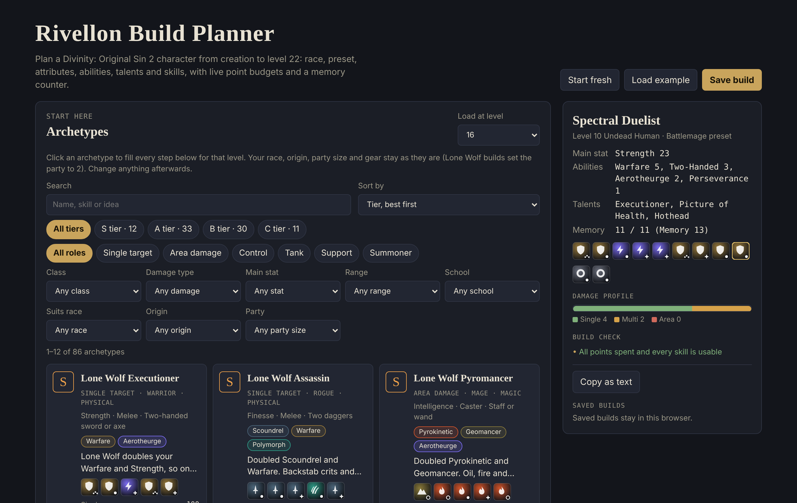
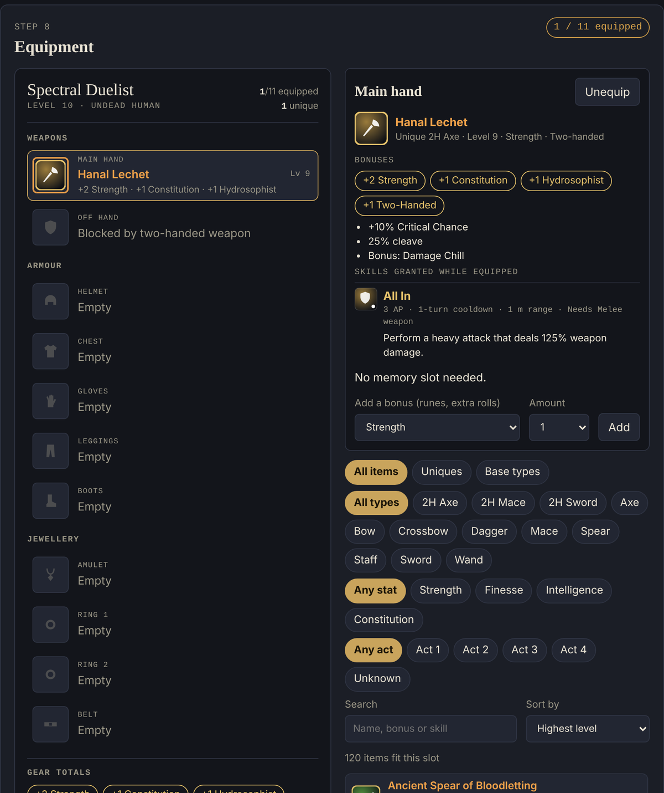

  

<h1 align="center">Rivellon Planner</h1>

  A character build planner for <b>Divinity: Original Sin 2 – Definitive Edition</b>. 
  Plan every point from character creation to level 22, compare tiered archetypes, and kit out your gear.

  <a href="https://voden6.github.io/rivellon-planner/"><b>Open the planner →</b></a>

  

## Features

**Archetypes**
- 102 ready-made builds across Warrior, Rogue, Ranger, Mage, Battlemage, Summoner, Tank and Support, including Lone Wolf builds and three for each origin character (Fane, Lohse, Ifan, Sebille, the Red Prince and Beast).
- Expected damage for every build at every level: how much it deals to one target and across a group over a two-turn opener, worked out with the game engine's damage formulas from the game's own stat files. Tiers (S to C) for damage builds come from those numbers.
- Filter by tier, role, class, damage type, main stat, range, skill school, race, origin and party size.
- Load any archetype at any level and every step fills in automatically, ready to edit.
- Each build's popup shows its damage per hit for every skill it uses, its rank, the buffs worth opening with and what it scales with, plus how to play it: a two-turn opener with AP costs, its combos, and which of its skills hit your own party.

**Act-by-act playthrough guide**
- For any loaded archetype: what to spend points on at every level, from character creation to level 22, including talents and which skills to learn or swap out.
- Gear goals for each act (Fort Joy, Reaper's Coast, Nameless Isle, Arx): the best unique for each slot that you can actually find by then, with its location, plus what to look for on rolled gear.
- Tick items off as you find them, and load the end-of-act build with its gear in one tap.

**Character creation**
- Origins and races, including undead variants, with their racial talents and skills.
- Attributes, combat and civil abilities, and talents, with live point budgets for the chosen level.
- Talent requirements, exclusions and party-size limits are enforced.

**Skills**
- Every learnable skill and spell, with AP, Source cost, cooldown, memory cost and requirements.
- A live memory counter and a check that flags anything your build can't use.

**Equipment**
- An 11-slot loadout with all 215 unique items and every base item type.
- Filter by type, attribute and act, and sort by level or act.
- Full item details, including the skills an item grants and where it's found.
- **Auto-pick best gear** fills every slot for your build with the best items you could have found by your level, based on your attributes and abilities.

  

## Game data

Skill, item, talent and stat values were extracted from the game's own data files. Item locations come from the game's level data, plus the [Fextralife](https://divinityoriginalsin2.wiki.fextralife.com/) and [dos2.wiki](https://dos2.wiki/) item pages: 195 of the 215 uniques list who drops them, which chest, which trader or which quest. Rolled gear in the guide and the Gear tab lists the traders that sell gear in each act. ### How damage is calculated

Damage numbers follow the engine's formulas (as documented in Norbyte's Script Extender, `Game.Math.lua`) with the constants from the game's `Data.txt`:

- **Spells** start from the level's base damage (`BaseLevelDamage`, which comes from the vitality curve), times the skill's damage multiplier, plus 5% per point of the skill's attribute above 10 and 5% per point in its school.
- **Weapon skills** start from an Epic weapon at your level (level-scaled weapon damage × the weapon type's `DamageFromBase`, +15% from the Epic damage roll). They add 5% per point in the weapon ability and in the weapon's attribute above 10, and Warfare for physical damage. Off-hand hits count at half damage.
- **Crits** use 1% chance per Wits point above 10 and the crit multiplier of 150%, plus Two-Handed and Scoundrel. Dagger builds count backstabs (always a crit), Huntsman archers count high ground, and weapon hits use 95% accuracy.
- **Buffs** (Enrage, Haste, Peace of Mind, Firebrand, Venom Coating, Elemental Arrowheads, Thick of the Fight) are counted whenever they pay back their AP.
- **Dynamic skills** use stated averages: storms hit 12 times over two turns across 3 enemies, Corpse Explosion assumes one corpse and Mass Corpse Explosion two, meteors and hail land at random across their area, and totems get one shot each.

The numbers are before enemy armour and resistances, and they leave out summons, damage over time and gear stats other than the weapon.

Skill and item icons load automatically from `rivellon-icons.json` when it's present next to `index.html`. Without it, icons can be imported from your own installation with **Import game icons** in the Skills section.

## Running it

The planner is a single static page with no build step or dependencies. Open `index.html` in a browser, or use the hosted version above. Builds are saved in your browser.

## Disclaimer

Rivellon Planner is an unofficial fan project and is not affiliated with or endorsed by Larian Studios. Divinity: Original Sin 2 and related names are trademarks of Larian Studios.
