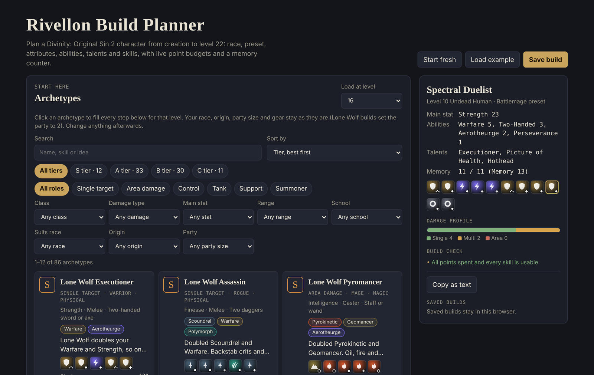
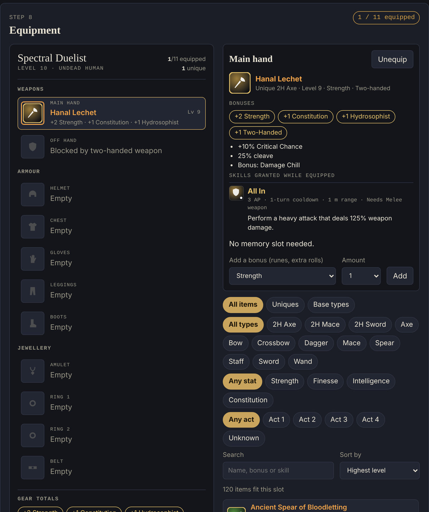

  

<h1 align="center">Rivellon Planner</h1>

  A character build planner for <b>Divinity: Original Sin 2 – Definitive Edition</b>. 
  Plan every point from character creation to level 22, compare tiered archetypes, and kit out your gear.

  <a href="https://voden6.github.io/rivellon-planner/"><b>Open the planner →</b></a>

  

## Features

**Archetypes**
- 86 ready-made builds across Warrior, Rogue, Ranger, Mage, Battlemage, Summoner, Tank and Support, including Lone Wolf and origin-character builds.
- Ranked S to C tier, with a damage index for single-target and area damage calculated from the game's skill data.
- Filter by tier, role, class, damage type, main stat, range, skill school, race, origin and party size.
- Load any archetype at any level and every step fills in automatically, ready to edit.

**Character creation**
- Origins and races, including undead variants, with their racial talents and skills.
- Attributes, combat and civil abilities, and talents, with live point budgets for the chosen level.
- Talent requirements, exclusions and party-size limits are enforced.

**Skills**
- Every learnable skill and spell, with AP, Source cost, cooldown, memory cost and requirements.
- A live memory counter and a check that flags anything your build can't use.

**Equipment**
- An 11-slot loadout with all 215 unique items and every base item type.
- Filter by type, attribute and act, and sort by level or act.
- Full item details, including the skills an item grants and where it's found.

  

## Game data

Skill, item, talent and stat values were extracted from the game's own data files. Item locations come from the game's level data where available. Tier rankings and the damage index are estimates meant for comparing builds, not exact in-game damage numbers.

Game artwork is not included. Skill and item icons can be added locally from your own installation with **Import game icons** in the Skills section.

## Running it

The planner is a single static page with no build step or dependencies. Open `index.html` in a browser, or use the hosted version above. Builds are saved in your browser.

## Disclaimer

Rivellon Planner is an unofficial fan project and is not affiliated with or endorsed by Larian Studios. Divinity: Original Sin 2 and related names are trademarks of Larian Studios.
